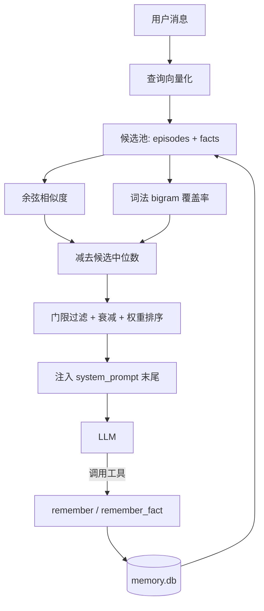

<p align="center">
  
  
  
  
</p>

# 大肥鱼记忆大脑

本地 SQLite 长期记忆 + 混合召回 + 每轮重钉人格锚点，不依赖任何云服务

> 当前版本：**v0.1.0** · 许可证：**[MIT](LICENSE)** · 作者：**[Caoran1314](https://github.com/Caoran1314)**

---

## 它解决什么问题

现有记忆插件通常有两个极端：

- **全塞 prompt**：把历史对话一股脑塞回去，token 爆炸，且模型会"念档案"
- **依赖云向量库**：要注册账号、要联网、数据离开本地

本插件走第三条路：**本地 SQLite + 混合召回 + 会遗忘**。

| 能力 | 说明 |
|---|---|
| 💾 **纯本地** | 单个 `memory.db`，无外部服务，无网络请求 |
| 🧠 **混合召回** | 向量（余弦）+ 词法（中文 bigram 覆盖率），缺嵌入服务时自动降级 |
| 📉 **会淡忘** | `importance × 0.99^天数`，被想起过的（`hits>0`）豁免 |
| 🎯 **人格锚点** | 每轮把核心设定重钉在 `system_prompt` 末尾，抵抗长对话人设漂移 |
| 🔧 **两个工具** | 给模型 `remember` / `recall`，让它自己决定记什么 |
| 🛡️ **规则兜底** | 模型忘了调用工具时，规则先接管；问句不会被误存 |

## 架构



## 五张表

| 表 | 存什么 | 关键字段 |
|---|---|---|
| `episodes` | 发生过的事 | `occurred_at` `gist` `importance` `hits` `embedding` |
| `facts` | 稳定事实（三元组） | `subject` `predicate` `object` `superseded_by` |
| `profiles` | 人物画像（预留） | `subject` `card` |
| `memory_ops` | 操作日志（可审计） | `op` `payload` `ts` |
| `state` | 维护状态 | `key` `value` |

## 打分是怎么算的

```text
base = 0.65 × normalize(cos − 候选中位数) + 0.35 × 词法覆盖率
       ↑ 对比式归一化，解决"无关内容余弦也有 0.5"的问题

final = base × e^(−Δt/τ) × 主人加权(1.8) × 命中加权(1+0.1·min(hits,5)) × 新鲜度(1.2)
        ↑ τ 按类型：core 36500 天 / important 30 天 / normal 7 天
```

> **为什么要减中位数？** 实测 bge-m3 对互不相关的中文短句余弦就有 0.40~0.56，
> 真正相关的才 0.63~0.74。绝对阈值根本分不开，减掉同批候选的中位数后信号才干净。

## 安装

### 方式一：插件市场（推荐）

面板 → 插件 → 插件市场 → 切到「大肥鱼插件集」→ 找到本插件 → 安装。

### 方式二：手动

```bash
cd AstrBot/data/plugins
git clone https://github.com/Caoran1314/astrbot_plugin_dafeiyu_brain.git
```

> 无第三方依赖。`numpy` 是可选加速项，没装也能跑（纯 Python 回退）。

## 接入嵌入服务（可选，强烈建议）

不开也能用（纯词法），但**换个说法就召回不上**。推荐本地 Ollama + bge-m3：

```bash
docker run -d --name ollama -p 11434:11434 \
  -v /你的路径/ollama:/root/.ollama ollama/ollama
docker exec ollama ollama pull bge-m3
```

然后在插件配置里填：

```json
{
  "embedding_enable": true,
  "embedding_api_base": "http://172.17.0.1:11434/v1",
  "embedding_api_key": "ollama",
  "embedding_model": "bge-m3"
}
```

开起来之后，历史记忆会**自动回填向量**（后台任务，每批 16 条，失败自动停）。

## 配置

| 配置项 | 类型 | 默认值 | 说明 |
|---|---|---|---|
| `enable` | bool | `true` | 启用记忆大脑 |
| `memory_inject` | bool | `true` | 关掉就只保留人格注入，不再回忆 |
| `embedding_enable` | bool | `true` | 没有本地嵌入服务时保持关闭，否则每次都会连接被拒（日志刷屏但会自动降级） |
| `embedding_api_base` | string | `http://172.17.0.1:11434/v1` | NAS 上 Ollama 的地址。容器内访问宿主机用 172.17.0.1 |
| `embedding_api_key` | string | `ollama` | Ollama 随便填，比如 ollama |
| `embedding_model` | string | `bge-m3` | 嵌入模型 |
| `embedding_timeout` | int | `8` | 失败会自动退化成纯词法检索，不会卡住回复 |
| `top_k` | int | `5` | 5 条左右最自然，多了像背档案 |
| `threshold` | float | `0.14` | 0.14 是绝对下限；实测相关约 0.13-0.31、不相关约 0.08，这个位置分得开 |
| `owner_qq` | string | `2224383507` | 用于给主人的记忆加权（1.8 倍） |
| `persona_file` | string | 空 | 留空则用插件目录下的 persona.json |
| `maintain_enable` | bool | `true` | 定期给记忆做衰减和清理，防止越积越多 |
| `maintain_interval_hours` | int | `6` | 维护间隔（小时） |
| `auto_capture` | bool | `true` | 模型忘了调用 remember 时，靠关键词规则先把重要的话存下来（不影响模型自主记忆） |
| `embedding_backfill` | bool | `true` | 开着的话，启动后会慢慢把没有向量的旧记忆补上；中途嵌入服务挂了会自动停 |

## 工具与命令

模型可主动调用两个工具：

| 工具 | 用途 |
|---|---|
| `remember` | 记一件**发生的事**（自动把"下周三"归一到绝对日期） |
| `remember_fact` | 记一个**稳定事实**（喜欢/讨厌/生日/住址…） |

管理员命令：

| 命令 | 作用 |
|---|---|
| `/brain` | 看统计（各表条数、召回次数） |
| `/brain search 关键词` | 手动查记忆，带分数 |
| `/brain export` | 导出 JSON（可迁移到别的机器） |
| `/brain maintain` | 手动跑一次衰减清理 |

## 人格装配

`persona.json` 控制两件事：

- **`core_anchor`**：每轮重钉的不可变设定（放 `system_prompt` 末尾，权重最高）
- **`entries`**：按关键词 / 轮次条件注入的补充条目，支持 `activate_only_every`（每 N 轮）、`activate_only_after`（N 轮之后）、`dont_activate_after_match`

安装包里的 `persona.json` 是**通用模板**，改成你自己的角色即可。

## 隐私

- 所有数据在 `data/plugin_data/dafeiyu_brain/memory.db`
- 插件本身**不发任何网络请求**；只有你主动开启嵌入服务时，才会把记忆文本发给**你自己配置的**端点
- 备份：`sqlite3 memory.db ".backup backup.db"`（**不要直接 cp**，WAL 模式会拿到半个事务）

## License

[MIT](LICENSE)
